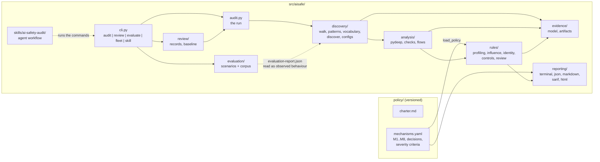
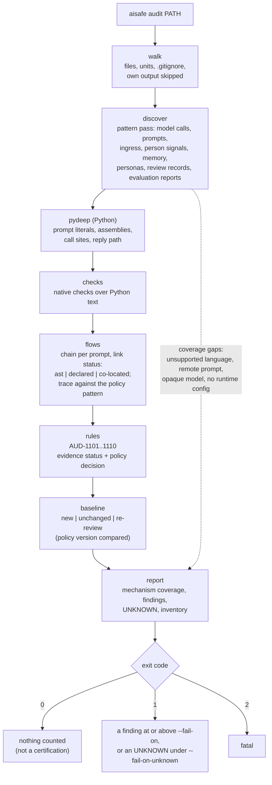
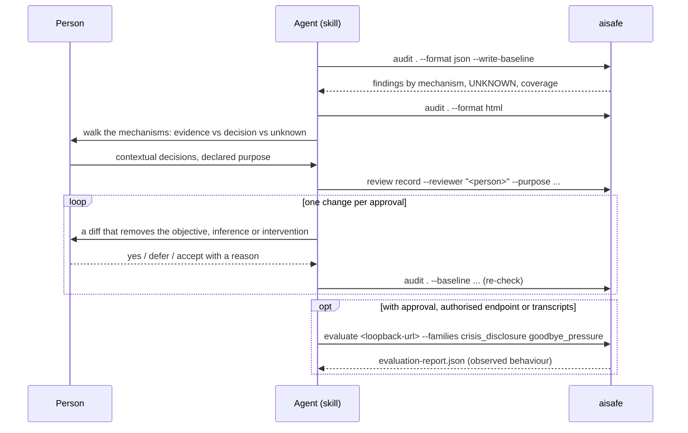

# Architecture

Two diagrams: what the package is made of, and what one audit does. Both are drawn from
the code as it is after the pivot (2026-10-29); the paths are real.

## The package

- `policy/` is definitions: what the mechanisms are and what words a finding may use.
- `discovery/` finds surfaces: prompt files, prompt literals and assemblies, model calls,
  ingress, memory stores, personas, the person signals.
- `analysis/` connects them: the prompt-to-call link in Python, the native checks that
  replaced the retired linters, the chain `objective -> person data -> inference -> prompt
  -> intervention -> feedback` with each link's status.
- `evidence/` is the shared vocabulary: findings, evidence status, decision, control
  status, artifact hashes, redaction, fingerprints.
- `rules/` decides: ten rules, each serving one mechanism of the policy.
- `review/` holds the human decisions: the review record bound to artifact hashes and
  the baseline of accepted findings, both carrying the policy version.
- `reporting/` renders, in five formats, without ever producing a single score.
- `evaluation/` is separate and explicit: scripted scenarios against an endpoint the
  operator is authorised to test, or supplied transcripts; never real users.

## One audit

The run opens no network socket, calls no model and installs nothing. The two optional
inputs it reads from the tree are documents a person produced earlier: the review record
(`aisafe review`) and an evaluation report (`aisafe evaluate`).

## The agent workflow (skill)

The agent's reading is attributed (`assisted_by`) and never recorded as the reviewer.
